# 01 — Code and data contract audit

**Question.** What does FOCUS already compute that a task valuation could reuse? Where would a valuation duplicate, or contradict, the scheduling and scoring authorities that already exist?

**Source revision.** All paths and line numbers below refer to commit `5d1236c` on `main` (2026-11-02). Nothing in the application was changed for this audit.

**Labels used throughout this investigation:**
- **VERIFIED CODE FACT**: read in the code at this commit.
- **EXPERIMENT**: measured by a run whose script and output are listed in `EVIDENCE_INDEX.md`.
- **THEORETICAL PROPERTY**: follows from the definitions.
- **ASSUMPTION**: stated explicitly where it is used.
- **UNVERIFIED**: not checked.

**Implementation status:**
- **VERIFIED_AVAILABLE**: implemented, and exercised by the fixture suite.
- **DEMO**: implemented under a demonstration policy or an assumed source, not approved for live use.
- **NOT_IMPLEMENTED**: not in the code.

## 1. End-to-end lineage

```mermaid
flowchart LR
  S[Source run: WIP census, flow budgets, graph, calendars, CS windows, parts, people, economics] --> SNAP[PlanningSnapshot<br/>data/snapshot_builder.py]
  SNAP --> CTX[EngineContext<br/>engine/model.py: phases, preds/succs, tails, shifts, pools]
  CTX --> SEED[Neutral seed decode<br/>greedy.Decoder, key = CPM tail]
  SEED --> W[derive_priority_weights + cost_of_delay<br/>economics/registry.py, urgency.py]
  W --> RED[Economic redispatch decode<br/>key = cost of delay, then tail]
  RED --> SRCH[Delay repair + neighbourhood search<br/>repair.py, neighborhoods.py]
  SRCH --> CMP{{Exact lexicographic comparison<br/>orchestrator.better}}
  CMP --> VAL[Independent validator<br/>validation/plan.py]
  VAL --> PUB[Publication: CandidatePlan + FrozenGoal per team-shift<br/>publication/serializer.freeze_goals]
  PUB --> EU[EarningUnit = assignment segment<br/>effort = phase standard person-minutes split by segment minutes]
  EU --> OBS[Observation feeds: lifecycle events, claims, decisions, amendments<br/>performance/actuals.py]
  OBS --> CRED[ObservationView._credit: verified completion credits units]
  CRED --> UF[UnitFact EARNED / MISSED / PENDING / UNKNOWN, relief, OOS<br/>lifecycle.unit_facts]
  UF --> SC[Canonical score B0 B E Cp U O<br/>performance/score.py]
  SC --> ROW[Light rows + job records<br/>performance/rollup.py]
  SC --> XP[Recognition XP, gate bonus, badges<br/>analytics/progression.py, points.py]
  ROW --> UI[Performance Over Time, Shift Performance, Arena]
  PUB --> TL[Team Lead ranking<br/>publication/dispatch.ranked_actions]
```

## 2. Evidence table

| Component | Path / symbol (5d1236c) | Current meaning | Status | Confidence | Reusable for valuation? | Limitations |
|---|---|---|---|---|---|---|
| Job identity | `focus/domain.py:221` `JobKey(site, program, line, native_id, revision, operation, effective_from, effective_to)` | A job is the SOI (`native_id`) on one line at one revision, operation and effectivity. `job.id` is a digest of the key. | VERIFIED_AVAILABLE | High | Yes: the canonical key | (line, SOI) alone is **not** unique across revisions and operations, and rework jobs are separate SOIs. |
| Phase identity | `focus/domain.py:257` `PhaseKey(job, kind, ordinal)`; `contracts/planning.py:126` `Phase` | Each job splits into kinds (WORK, IP_QA, FINAL_QA, OTHER_BUYOFF, RELEASE) and ordinals. Long work is cut into segments of at most `duration.max_segment_minutes` = 240 (`data/inspections.py:121`). | VERIFIED_AVAILABLE | High | Yes: the scheduling grain | One SOI has many phases, so "task" must mean phase or job explicitly. |
| Earning unit | `contracts/planning.py:795` `EarningUnit`; `publication/serializer.py:104-145` `freeze_goals` | One unit per assignment segment in the obligation day (`goals.obligation_days` = 1). Its effort is the phase's `standard_person_minutes`, split over segment minutes by largest remainder (`_split`, `:86-96`). RELEASE phases and phases with no role demand earn nothing (`earning_phase`, `:99-101`). | VERIFIED_AVAILABLE | High | Yes: the right grain for any earned points | Effort is not engineered. It is elapsed × crew (next row). |
| Standard effort | `config/policies/rebuild-v1.json:291` `duration.standard_effort_basis = ELAPSED_TIMES_CREW` (fixture_default); `docs/execution/DURATION_METHOD.md:25` | Standard person-minutes = scheduled elapsed minutes × crew size. Rework elapsed time is P75 of a comparable cohort (`DURATION_METHOD.md:47-82`). | DEMO (fixture basis) | High | Yes, as a work-content unit | **Not an engineered labor standard.** Rework "standards" are schedule estimates (P75), so effort points inherit estimation error. |
| CPM tail | `engine/model.py:285-318` `EngineContext._tails` | A node's own `work_minutes` plus the longest successor tail, in pure work minutes. It ignores lags, calendars, shifts, crews and parts. | VERIFIED_AVAILABLE | High | Partly: as a path-length signal | Not a float and not resource-constrained. Units are elapsed work minutes, not calendar time. |
| Dispatch priority key | `optimizer/orchestrator.py:153-169` `make_priority` | `(fixed rank, search rank, −cost of delay, −CPM tail, phase id)`. This is a **sort key**, not a value. | VERIFIED_AVAILABLE | High | Its order only | It is lexicographic, so only the cost-of-delay field carries a quantity. Search ranks are perturbations. |
| Dispatch classes | `optimizer/greedy.py:51` (`LEAD_DEFENDED, LEAD_CONE, LEAD_HINT, LEAD_OTHER`); `:194-202` `_key` | Defended commitments, then their prerequisite cone, then repair hints in incumbent start order, then everything else by the key. | VERIFIED_AVAILABLE | High | No | Commitments lead regardless of urgency, so early placement can reflect stability policy, not importance. |
| Decoder | `greedy.py:205-270` `Decoder.run`; `:134-157` `_floors` | Ready-frontier list scheduling. A phase enters the heap when all its predecessors are resolved, and is placed at its earliest feasible opening (floors from predecessors with typed lags, the job floor, releases). | VERIFIED_AVAILABLE | High | It is the counterfactual engine for model D | Placement order is not time order: a lower-key phase can take an earlier gap (backfill). Greedy, so not proven optimal. |
| Cost of delay | `optimizer/urgency.py:92-116` `cost_of_delay`; `:35-41` `COD_STEP_MINUTES`, `COD_DECAY`; `:43-89` `OpenClock` | Per phase: the aircraft's marginal penalty of one more day × `COD_DECAY[slack // 360]`. Slack = latest start (due date minus the CPM tail, on the line's open clock) minus the start in the seed. One day of slack divides it by e; it is zero past about 14.75 days. | VERIFIED_AVAILABLE | High | As a ranking signal only | Integer cents × 10⁶ (the millionths are never divided out). Slack is measured against the **due date**, not the projected completion. Every phase of a late aircraft clamps to full weight. Pure-work tail, computed on the seed, not the plan. |
| Aircraft priority weights | `economics/registry.py:86-108` `derive_priority_weights`; `:65-84` `penalty`, `marginal` | Marginal penalty of one more day at the projected completion. Normalized only in the receipt (`normalized`). An unknown completion is evaluated at the due date. | VERIFIED_AVAILABLE | High | Yes: aircraft-level $/day | An aircraft projected early has marginal 0 until a slip crosses its due date. |
| Penalty model | `registry.py:65-78` `penalty`; `economics/repository.py:142-152` (due); `:188-191` (cap) | LINEAR_DAILY: rate × days past due, floored by an accrued checkpoint. **Caps are never applied** (`EXPLICIT_ONLY` leaves `cap = None`). The due date is the planned CS744 unload + 2-day grace (OD-06, owner decision 2026-11-02). | VERIFIED_AVAILABLE (rates DEMO) | High | Yes, as the money unit | The rate is the airline ticket-revenue proxy (`fixtures/economics/README.md`): a planning assumption, not a contract or a realized loss. |
| Candidate cost | `economics/evaluator.py:37-60` `aircraft_completions`; `:63-96` `line_costs`; `:99-113` `summarize` | Completion = last release of all required open jobs. Any unreleased required job makes it **unknown**, and unknown aircraft are excluded from money. Cost is split into total, unavoidable (at cutoff) and controllable. | VERIFIED_AVAILABLE | High | Yes: J for model D | Executable plans leave unreleased work out, so aircraft completions go unknown: 5 of 5, 9 of 10 and 20 of 20 in the study runs (EXPERIMENT, `06`). |
| Objective | `orchestrator.py:94-108` `OBJECTIVE_FIELDS`, `key_levels`; `config/policies/rebuild-v1.json:607` `objective.order`; `:232-267` `evaluate`; `:278-299` `better` | Lexicographic: 1. commitments defended, then exact; 2. unknown-completion aircraft; 3. controllable known cents; 4. travel+wait minutes; 5. overtime minutes, then continuity breaks; 6. deferred phases; 7. signature. `better` refuses a money win across different unknown sets and any commitment loss. | VERIFIED_AVAILABLE | High | Defines what "better for the fleet" means | Not a scalar. Any task value claiming to be "the objective's" must say which level it measures. |
| Repair mode | `orchestrator.py:300-326` `_run_repair`; `repair.py:1-30` | Keep incumbent placements whose slot and crew still hold, then redispatch by cost of delay. Two decodes; the second is kept only when strictly better. | VERIFIED_AVAILABLE | High | A cheaper counterfactual protocol (model D2) | Kept slots force a displaced chain to land later, an artifact measured in `06`. |
| Long waits | `urgency.py:119-131` `long_waits`; `greedy.py:118` `DecodeResult.waits` | Minutes past each phase's earliest start. Feeds search moves. | VERIFIED_AVAILABLE | High | A resource-pressure signal | Not a float. |
| Resource-constrained float | (searched: `urgency`, `model`, `greedy`, `validation`) | None. No measure of slack that accounts for crews, positions or tools exists. | NOT_IMPLEMENTED | High | — | Needs a schedule-graph pass (model B-RC in `03`). |
| Team Lead ranking | `publication/dispatch.py:178-192` `ranked_actions`; `web/serializers.py:1360` `team_lead` | Dispatchable first, then committed, then planned start, then id. This is the one ranking authority for the view and for explanations. | VERIFIED_AVAILABLE | High | It is the "prioritized task list" today | No value or importance shown. The ranking is time order plus readiness. |
| Explanations | `explanations/pipeline.py:104-172` `candidate_set` | Facts per action: rank, dispatch status, blockers, ready-after, crew, duration, commitment, and **aircraft** marginal $/day (economics grant). | VERIFIED_AVAILABLE | High | A place to show a task value with provenance | No per-task value fact. |
| Goal freeze (B0) | `serializer.py:104-145`; `contracts/planning.py:821` `FrozenGoal` | Per team-shift: units, total standard effort, gate contexts per job, membership. Frozen at publication and hash-checked. | VERIFIED_AVAILABLE | High | Yes: where a frozen per-task value would live | The obligation is the published plan's first day only. |
| Crediting | `performance/lifecycle.py:768-794` `ObservationView._credit`; `:652` `select_goal` | A verified phase completion credits the units of the goal whose window or grace window contains it. Segment completions credit their segment. A unit is never credited twice (`u.id not in self.credits`). A late completion becomes off-plan `LATE_FOR_GOAL`. | VERIFIED_AVAILABLE | High | Yes: event-based earning | No partial credit inside a segment; progress is by segment. |
| Unit status | `lifecycle.py:824-850` `unit_facts` | EARNED (credited), UNKNOWN (unknown lifecycle), PENDING (window open), MISSED. Relief only for MISSED units with approved decisions. | VERIFIED_AVAILABLE | High | Yes | — |
| Relief / excusal | `performance/disruption.py:281-327` (`effective_claims`, `effective_decisions`, `approved_units`, `relief_summary`) | Claims are proposed or submitted; relief needs a decision by the server-granted `excusal_decider` role (`web/api.py:393`). Relief is the union of approved missed units. | VERIFIED_AVAILABLE | High | Yes: keeps relief independent of valuation | Live producers do not exist yet (OD-15). |
| Score | `performance/score.py:95-108` `formula`; `:113-137` `components`; `:152` `status_and_score` | B0, B = B0 + approved additions, E = relief, Cp = earned, U = off-plan, O = 0.10 × affected effort of evidenced discretionary OOS. D = B − E; A = min(1, Cp/D); H = Cp/(Cp+U). base = 100(0.70A + 0.30H); final = clamp(base − 100·O/D). | DEMO (`score.policy_status = DEMONSTRATION`, `grading-demo-v1.json:8-15`) | High | It is the existing execution grade | The weights are demo defaults. H rewards a lack of off-plan work even when attainment is low (`05`). |
| Pooling / rollups | `score.py:140-150` `pooled`, `:270` `aggregate`; `performance/rollup.py:432` `rollup`, `:508` `job_patterns` | Sums of components before division; job records add up to B, Cp, E and U (D-25). | VERIFIED_AVAILABLE | High | Yes: any new per-unit value can ride the job record | — |
| Recognition XP | `analytics/points.py:57-94` (`gate_context`, `unit_values`); `analytics/progression.py:99-136` `entitlements` | `completion_credited` = earned effort / 5. `gate_recovery` bonus = base × 35% × behind-gate factor (frozen at publication) — **an existing bounded importance multiplier (1.00–1.35×)**. | DEMO (`recognition.base_divisor` demo_default) | High | It is an existing hybrid (model F) to learn from | Recognition only; it never changes the grade. |
| Unlock recognition | `progression.py:139-177` `_unlocks` | `dependency_unlocked` (value 0): a completion that was the **last** prerequisite of downstream jobs, in the same admitted graph. | VERIFIED_AVAILABLE (zero value) | High | It is a realized-unlock attribution rule (last-to-finish) | It credits only the last finisher. |
| Simulation | `focus/sim/` (`runner.py`, `execute.py`, `engine.py`) | A shift-by-shift synthetic plan, publish and execute loop on the production engine. | VERIFIED_AVAILABLE (synthetic) | High | The test bed for shadow studies | Synthetic floor model, not operations data. |

## 3. Implemented versus documented versus missing

- **VERIFIED_AVAILABLE, reusable as is:**
  - canonical job, phase and segment identity;
  - frozen team-shift goals with per-unit standard effort;
  - event-based, non-duplicating credit;
  - independent relief;
  - the lexicographic candidate evaluation;
  - aircraft-level modeled $/day;
  - repair-mode decoding;
  - per-job outcome records that add up to the score;
  - the Team Lead ranking and explanation fact pipeline.
- **DEMO:**
  - score weights and bands;
  - recognition divisor and gate weight;
  - the penalty rates (airline revenue proxy);
  - the standard-effort basis (elapsed × crew).
- **NOT_IMPLEMENTED:**
  - any per-task value, in money or points;
  - resource-constrained float;
  - counterfactual task deferral;
  - shared-impact attribution;
  - a task value in the plan, goal, job record or UI.

## 4. Correct grain for points

- **Earning grain:** the `EarningUnit` (plan, assignment, segment). It is unique, frozen, credited once and already summed by every rollup. Any earned-points currency must live here or it will double count. One SOI has many phases, and one phase can have several segments and shifts.
- **Valuation grain:** the phase. That is what the scheduler places, and what a deferral counterfactual moves. A phase value must be split across its units (for example, in proportion to segment effort, as `_split` already does) before anything is earned.
- **Display grain:** (line, SOI) for leadership. That is an aggregate over phases and units and must never be summed again with them.

## 5. Semantic traps found

1. **The priority key is not a value.** `make_priority` is a lexicographic tuple. Treating `-urgency` as "points" ignores the dispatch classes and search ranks that precede it.
2. **The cost of delay is the ATC heuristic, not a marginal value.** Its slack is measured against the due date with a pure-work tail on the seed. For a late aircraft every phase gets the full aircraft weight (slack clamps at 0).
3. **Early placement is not importance.** Commitments lead by policy (`greedy.py:194-202`), and backfill puts lower-key phases into earlier gaps.
4. **The executable plan has no money.** Unknown completions remove its aircraft from `controllable_known_cents`, so its acceptance falls to travel+wait. Money exists only in the FORECAST plan.
5. **Caps are never applied.** "Capped economics" cannot arise with current data, so a valuation must not assume a cap exists.
6. **Early aircraft carry $0** until a slip crosses the due date. No carrying cost is modeled.
7. **Standard effort is a schedule estimate** (elapsed × crew; rework at P75). An effort currency rewards estimation error as well as work.
8. **(line, SOI) is not an earning event.** Phases, segments, revisions and rework SOIs all separate events.
9. **Recognition is not the grade.** XP has its own frozen gate bonus and is demo policy. The grade never reads XP.
10. **The score is DEMO.** No official weights exist (OD-16), so any "points versus scheduled points" grade is equally undecided.

## 6. Missing data for an accurate economic or constrained-slack valuation

- **Economics:**
  - contract terms (OD-12: no live terms, caps or checkpoints);
  - any carrying or holding cost per aircraft-day;
  - customer delivery dates (none in any source; the due date is the CS744 proxy, OD-06).
- **Constrained slack:**
  - person-level and position-level resource sequences are in the plan artifact (duties and assignments), but tools and positions are only partly modeled;
  - no historical record of disruption consequences (the observation producers are proposed, OD-15).
- **Validation:** no operational history of executed plans versus outcomes exists in this repository. Every experiment here is synthetic.
