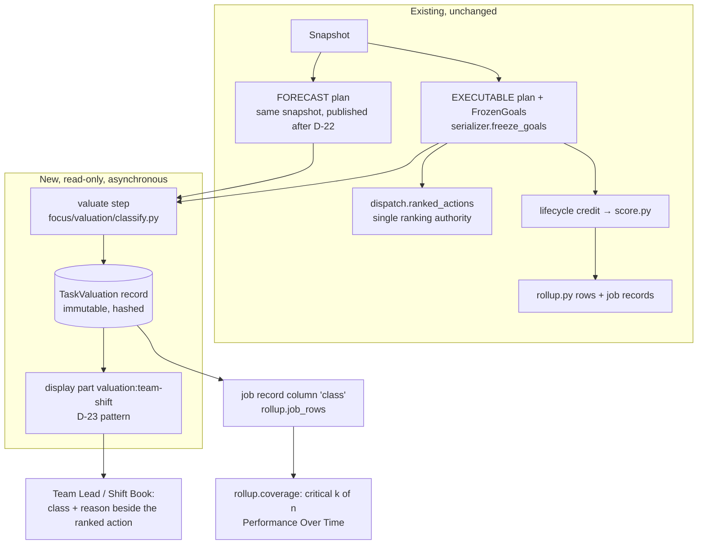

# 07 — Integration options (design only; no code changes authorized)

**Source revision:** `5d1236c`.

**Ground rules:**
- The scheduler remains the only authority for feasibility and sequence.
- No option below changes the plan, the goals of record, the validator, `score.py` or recognition XP unless it says so explicitly, and every such change sits behind a decision gate.

## 1. Options

| Option | What changes | Earned points | Priority display | Verdict |
|---|---|---|---|---|
| **A** — Expose explainable priority, earning unchanged | Facts already computed (ready-after, commitment, aircraft marginal $/day) are surfaced more clearly in the Team Lead view | Effort (unchanged) | Existing ranking + better reasons | Least effort and least risk. Does not identify critical work. |
| **B** — Effort earning + frozen priority classes + critical coverage (model G) | A read-only TaskValuation artifact per published plan pair. Classes in the Team Lead view, Shift Book and job records. Coverage in rollups. | Effort (unchanged) | Ranking unchanged; class and reason shown beside each action | **Recommended**, subject to the shadow gates in `06` |
| **C** — Additive impact points | Impact values in the goal; score on impact | Impact | Impact | **Rejected**: non-additive (`04` §3), endogenous (`05` §1), procrastination incentive (`05` case 4), mostly $0 near term (`06` §2.3). Revisit only if every condition in `04` §3.6 is shown to hold. |
| **D** — Management delay-cost ledger (companion to A or B) | Per-aircraft change in forecast cost between publications, split into missed obligation units, by cause, and other changes, so the parts add up to the total | None | None (management analytics, economics grant) | Recommended as a separate later phase. Not team points. |

## 2. Architecture (Option B, with D later)



**Timing.**
- D-22 publishes the EXECUTABLE plan (and its goals) first, then the FORECAST plan on the same snapshot.
- Classes need the FORECAST plan (money lives only there, `01` trap 4), so **they cannot be frozen inside `FrozenGoal` at executable publication.**
- They are instead a separate immutable record, bound to the goal ids, written once when the forecast is accepted. That moment is defined as the class freeze. It never changes afterwards, even if later plans re-classify the same phase.

## 3. Data contracts (typed sketch)

```python
@dataclass(frozen=True, slots=True)
class TaskClassEntry:
    phase_id: str                 # PhaseKey digest (job key + kind + ordinal)
    line: int
    soi: str                      # JobKey.native_id; revision and operation kept below
    revision: str | None
    operation: str | None
    unit_ids: tuple[str, ...]     # the EarningUnits of the obligation this phase maps to (may be empty)
    klass: str                    # CRITICAL | AT_RISK | FLOAT | UNKNOWN
    reasons: tuple[str, ...]      # e.g. COST_FLOAT_LT_SHIFT, AIRCRAFT_LATE, ECONOMICS_UNKNOWN, QA_SEQUENCE
    cost_float_minutes: int | None
    modeled_delta_cents: str | None   # optional proxy dollars for one-shift slip; labeled MODELED, never summed
    aircraft_state: str           # late | early | unknown | unsupported
    placement_plan: str           # which plan's placement was valued (FORECAST id)

@dataclass(frozen=True, slots=True)
class TaskValuation:
    id: str                       # digest(executable plan, forecast plan, method, policy hash)
    executable_plan_id: str
    forecast_plan_id: str
    snapshot_id: str
    policy_hash: str
    engine: str                   # orchestrator ALGORITHM/VERSION + native protocol
    method: str                   # e.g. "RC_RIGHT_SHIFT_V1" (proxy c) or "PRECEDENCE_FLOAT_V1" (proxy b)
    horizon_minutes: int          # Δ (one shift) and K·Δ thresholds recorded
    computed_at: datetime
    status: str                   # COMPLETE | PARTIAL | UNAVAILABLE (with reasons)
    entries: tuple[TaskClassEntry, ...]
    hash: str
```

- **Optional `TaskValueAttribution`** (Option D only): aircraft, period, Δ controllable cents (exact, from consecutive plans), and allocated shares per missed unit or cause, with `rule` (SHAPLEY_SAMPLED, PROPORTIONAL or JOINT_RESIDUAL), `samples` and `range`. Management scope only.
- **Canonical key.** Units stay (plan, assignment, segment). Phase is (site, program, line, SOI, revision, operation, effectivity, kind, ordinal). An SOI-level display aggregates phases and is never summed with them.

## 4. Touchpoints

| Concern | Module | Change | Unchanged |
|---|---|---|---|
| Classification | **new** `focus/valuation/classify.py` | Cost float (`04` §1) on the published FORECAST schedule graph: precedence with lags + person and position sequence edges + shift windows. Classes and reasons. | Engine, decoder, objective |
| Contracts | **new** `focus/contracts/valuation.py` | `TaskValuation`, `TaskClassEntry` | `planning.py` contracts |
| Pipeline | `focus/orchestration.py` | New step `valuate` after `forecast_sign_accept`; `allow_failure`; never on the `sign_accept` path | Existing steps and their order |
| Persistence | `data/repositories.py`, `data/store.py` | Immutable collection `task_valuations`; a display part `valuation:<team-shift>` | Store deletion allowlist (valuations are kept; their display parts follow D-24) |
| Team Lead / Shift Book | `web/serializers.team_lead`, `shiftbook` | Add class, reason and cost float beside each ranked action | `dispatch.ranked_actions` ordering (MVP) |
| Explanations | `explanations/pipeline.candidate_set` | New fact rows `priority_class`, `cost_float_minutes` (grounded facts) | Validator, provider |
| Job records | `performance/rollup.job_rows`, `record_jobs` | Add `class` column per unit, copied from the TaskValuation of the goal's plan pair | Score components |
| Coverage | `performance/rollup.py` | `coverage(level, node, period)` over job records: critical scheduled, done and relieved | `rollup()` arithmetic |
| SQL (draft) | **new** `sql/migrations/011_task_valuation.sql` (draft) | `FOCUS_FN_TaskValuation` + `PriorityClass` on `FOCUS_FN_JobOutcome` | 001–010 |
| API / MCP | `web/api_views.py` | `GET /api/v1/valuation` (scoped like `/performance/jobs`); class fields on `/team-lead`, `/shiftbook`, `/performance/jobs`. MCP follows automatically. | Command APIs |
| Policy | `config/policies/rebuild-v1.json` | `valuation.method`, `valuation.horizon_shifts` (K), as `demo_default` | Score weights, recognition |
| Recognition | `analytics/progression.py` | None in MVP | Gate bonus stays separate |
| Twin | `web` twin projection | Optional class layer later. No causal credit is claimed from coincident plan changes. | Twin reconciliation |

## 5. Updating versus freezing

| Shown | Updates? | Rule |
|---|---|---|
| Live priority (Team Lead "what to do now") | Yes: each new plan pair re-classifies | Labeled "as of plan X, HH:MM" |
| Frozen class used for coverage | No | First valuation for the goal's plan pair; immutable; its version is shown on the grade |
| Earned effort, B0, B, E, D | Already frozen and event-based | Unchanged |
| Modeled dollars | Per plan | Always "modeled at publication, not realized"; never summed across tasks |

When a live class differs from the frozen one, the UI shows both: "planned as AT_RISK, now CRITICAL". The grade uses the frozen one only.

## 6. Phased plan, gates and rollback

1. **Phase 0 (done):** audit and investigation (this report set).
2. **Phase 1, shadow:**
   - Implement `classify.py` and `TaskValuation` behind `FOCUS_VALUATION_MODE=shadow`. Compute and store in the synthetic simulation and fixture pipeline only. Nothing is displayed.
   - Gate: `06` T1–T3, T5, T10 and T11 pass at 20 and 50 aircraft.
3. **Phase 2, shadow study:**
   - 14 × 3 synthetic shifts (`06` §5).
   - Gate: T8 (CRITICAL slips move delivery more than FLOAT, CI excludes 0) and the coverage-versus-attainment correlation < 0.9.
4. **Phase 3, display:**
   - `FOCUS_VALUATION_MODE=display`: classes in the Team Lead view and Shift Book; coverage in Performance Over Time. Earning is unchanged.
   - Gate: owner and leadership review of explanations; fairness review (T9).
5. **Phase 4, optional:**
   - Option D ledger for management.
   - Gate: owner decision on economics visibility, and validation against real outcomes once live feeds exist (OD-15).
6. **Never, without new evidence:** Option C.

**Dependencies.**
- Phase 1 needs the FORECAST plan and its duties and assignments (VERIFIED in the artifact, `06` data note).
- Live use needs the live adapter (SQL 001–010 not installed) and the observation producers (OD-15).

**Failure modes and rollback.**
- If the valuation step fails or overruns, the pipeline continues (`allow_failure`) and the UI shows "classes unavailable".
- Flag `off` makes every surface revert. Scores never read valuations, so rollback cannot change any grade.
- Valuations are rebuildable from immutable inputs (snapshot, plans, method version).

**Performance budget.**
- ≤ 60 s and ≤ 2 GB extra at 50 aircraft, asynchronous (T11).
- Measured basis: 1.7 s at 5 aircraft and 1.7 s at 10 for the graph build and all units. The 50-aircraft figure is NOT_MEASURED and must be measured before Phase 1 exits.

**Communications.**
- Classes are labeled as planning signals, not grades.
- Coverage is labeled diagnostic.
- No modeled dollars are shown to teams.
